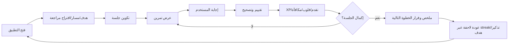
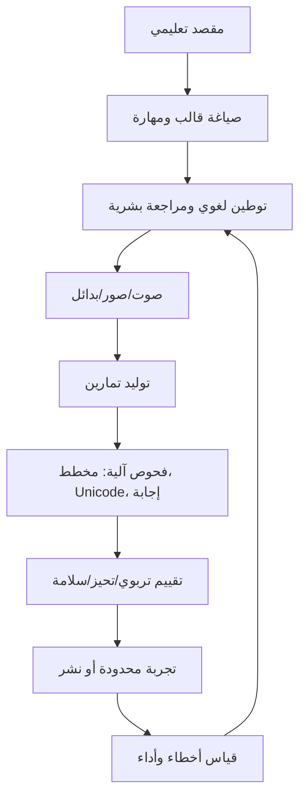
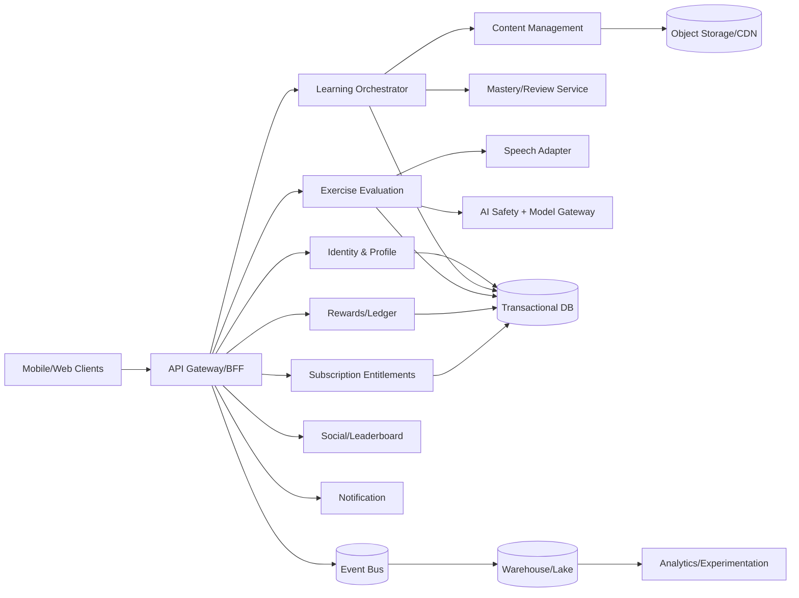

# DUOLINGO — COMPLETE PRODUCT & TECHNICAL RESEARCH SPECIFICATION

> **اللغة:** العربية مع إبقاء أسماء المنتجات والمفاهيم التقنية بالإنجليزية عند الحاجة.  
> **As of:** 2026-11-09.  
> **الغرض:** مواصفة بحثية شاملة للمنتج، لا تمثل وثيقة داخلية أو كشفاً لخوارزميات Duolingo غير المنشورة.

## 0. ملخص تنفيذي

Duolingo هو منتج تعلّم لغات رقمي مبني حول جلسات قصيرة، تكرار متباعد، تغذية راجعة فورية، ومسار تعلّم مرئي تدعمه أنظمة تحفيز اجتماعية واقتصادية. القيمة الأساسية ليست «كتاباً رقمياً» بل حلقة استخدام متكررة: يختار المستخدم هدفاً أو درساً، يتلقى مجموعة تمارين متعددة الوسائط، يجيب، يحصل على تصحيح ومكافأة، ثم يُعاد توجيهه إلى نشاط لاحق مناسب لمستواه أو لأخطاء سابقة.

هذه الوثيقة تفصل بين:

- **حقيقة موثقة (A):** معلومة منشورة من Duolingo أو مصدر أولي رسمي.
- **ملاحظة مباشرة (B):** سلوك أو شاشة تمت معاينتها مباشرة في نسخة محددة؛ قد يختلف حسب المنصة، البلد، الحساب، اللغة، وتجربة الاختبار.
- **تقرير خارجي موثوق (C):** صحافة تقنية أو دراسة أكاديمية أو إفصاح شركة ذي صلة.
- **استنتاج هندسي معقول (D):** تفسير معماري لا يُنسب إلى Duolingo كحقيقة.
- **توصية أو فرضية تصميم (E):** اقتراح لبناء نظام مماثل أو لتحقق لاحق.

لا ينبغي قراءة أي رسم أو مخطط مقترح أدناه على أنه مخطط البنية الداخلية الفعلي لـ Duolingo.

## 1. نطاق البحث والمنهج والحدود

### 1.1 ما يغطيه التقرير

يغطي التقرير المنتج الاستهلاكي الأساسي، مسار التعلّم، عائلات التمارين، التلعيب، الجوانب الاجتماعية، الاشتراكات والذكاء الاصطناعي، الشاشات وتجربة الاستخدام، هندسة المحتوى متعدد اللغات، البنية التقنية المقترحة، نماذج البيانات، قواعد النظام، نقاط المراقبة، ومصفوفة النواقص.

### 1.2 ما لا يدّعي التقرير معرفته

لا يثبت التقرير ترتيب الوحدات الداخلي الفعلي، أو قيم XP/Gems/Hearts الخاصة بكل نسخة، أو حدود الاختبارات، أو الأسعار الحالية في كل سوق، أو خوارزمية التكييف، أو تفاصيل البنية السحابية والـ microservices، أو عقود API، أو بيانات التدريب، أو قواعد الإشراف الداخلية. هذه العناصر متغيرة أو مملوكة أو تعتمد على التجارب (experiments).

### 1.3 سياسة الزمن والحقائق المتقلبة

«As of 2026-11-09» هو تاريخ القطع. الأسعار، أسماء الخطط، توافر الميزات، مواضع عناصر التنقل، عدد اللغات، أنواع التمارين، حدود الاشتراك، وتفاصيل Max/AI قد تتغير. كل حقيقة متقلبة يجب إعادة التحقق منها عبر التطبيق/المتجر/صفحة المساعدة الرسمية قبل استخدامها في قرار منتج أو شراء أو امتثال.

## 2. هوية المنتج ونموذج القيمة

### 2.1 الوعد الوظيفي

1. **بدء فوري منخفض الاحتكاك:** اختيار لغة وهدف يومي بدلاً من إعداد دورة تدريبية معقدة.
2. **وحدات صغيرة قابلة للإنجاز:** تقدم سريع في جلسة قصيرة، مع عرض الحالة عبر مسار واضح.
3. **ممارسة نشطة:** استرجاع، تمييز، ترجمة، استماع، نطق، وتركيب جمل؛ لا يقتصر التفاعل على القراءة.
4. **حلقة دافعية:** XP، streak، مستويات/دوريات، مهام، مكافآت، ومؤشرات تقدم.
5. **خطة مجانية مع ترقية مدفوعة:** الاحتفاظ بجزء كبير من الحلقة الأساسية مجاناً، مع إزالة احتكاكات أو إضافة امتيازات في الخطط المدفوعة.
6. **طبقة اجتماعية:** المتابعة، الأصدقاء، لوحات الصدارة، والإنجازات؛ فعاليتها تعتمد على إعدادات الخصوصية والمنطقة والنسخة.

### 2.2 الشخصيات والوظائف الرئيسية

| الشخصية | الهدف | الاحتياجات النظامية | مؤشرات نجاح محتملة |
|---|---|---|---|
| مبتدئ | بدء عادة وفهم الأساسيات | مسار واضح، شرح قليل، تصحيح غير مخيف | إكمال أول درس، العودة في اليوم التالي |
| متعلم مستمر | المحافظة على العادة وتحسين الضعف | مراجعة، تكرار متباعد، تخصيص | دقة الاسترجاع، أيام نشطة، تراجع أخطاء |
| متعلم متقدم | استعمال اللغة في سياق | محتوى أصعب، استماع/محادثة، قصص | إكمال وحدات متقدمة، أداء إنتاجي |
| مستخدم مجاني | التعلم دون دفع | قيمة أساسية وحدود واضحة | إكمال الدروس، قبول الإعلان/الاحتكاك |
| مشترك | تقليل الاحتكاك أو طلب AI | تجربة بلا إعلانات/قيود ذات صلة، ميزات مميزة | احتفاظ، استخدام الميزات المميزة |
| ولي أمر/معلم | متابعة تعلم آخرين | حسابات وإشراف وتقارير | نشاط المجموعة، إكمال الأهداف |

### 2.3 الحلقة الأساسية (Core Loop)



**المدخلات:** هوية المستخدم، اللغة، عقدة المسار، المهارات السابقة، الإجابات الحديثة، وقت الجلسة، حالة الاشتراك، إعدادات الجهاز والخصوصية.  
**المخرجات:** تمرين تالٍ، نتيجة وتفسير، تغيير في الإتقان، عملة/XP، حدث تحليلي، توصية، وإشعار اختياري.  
**قواعد معلنة/معقولة:** لا تُحتسب الإجابة قبل إرسالها؛ لا ينبغي أن يغير فشل الشبكة حالة المستخدم مرتين؛ التقدم القابل للعرض يجب أن يكون قابلاً للتدقيق من سجل المحاولات.  
**مجهول:** الصيغة الدقيقة لترجيح كل عامل، وعلاقة XP بنتيجة التعلم، وترتيب التجارب.

## 3. جرد الميزات (Feature Inventory)

### 3.1 التعلم والمحتوى

- مسارات لغة من لغة أساس إلى لغة هدف، مع وحدات/مهارات/دروس أو عقد مكافئة.
- اختبار تحديد مستوى أو تخطي أجزاء عندما يكون متاحاً.
- دروس قصيرة متسلسلة مع أهداف ضمنية أو معلنة.
- كلمات وعبارات وقواعد داخل سياق.
- استماع وتمييز صوتي ونطق، حيث يدعم الجهاز واللغة ذلك.
- ترجمة ثنائية الاتجاه، اختيار متعدد، كتابة، ترتيب كلمات، ملء فراغ، وصل أزواج، وإملاء.
- مراجعة أخطاء أو كلمات، ومحتوى متكيف محتمل.
- قصص أو محتوى سياقي/قراءة في اللغات التي تدعمه النسخة.
- لوحة تقدم داخل المسار، ومؤشرات إتقان على مستوى مهارة أو وحدة.

### 3.2 التحفيز والاقتصاد

- XP كمؤشر نشاط أو تقدم تنافسي.
- streak كسلسلة أيام نشاط؛ قد تدعمها إصلاحات أو تجميد أو مكافآت، ولا يجوز افتراض تفاصيل كل سوق.
- Gems/عملة افتراضية لعمليات داخلية، مع اختلاف الاسم أو الاقتصاد بين المنصات.
- Hearts/محاولات أو حدود للإجابة في بعض التجارب المجانية؛ السلوك والحدود متغيران.
- صناديق، مكافآت، تحديات، quests، milestones، badges أو شارات حيث تكون متاحة.
- leagues/leaderboards ومراكز أسبوعية أو دورية.
- إعلانات أو عروض ترقية في الخطة المجانية بحسب المنصة والمنطقة.

### 3.3 الاجتماعي

- ملف شخصي وإحصاءات مختصرة.
- متابعة/أصدقاء وتغذية نشاط حيث تسمح الخصوصية.
- منافسة جماعية عبر leaderboard.
- دعوات أو مهام اجتماعية محتملة.
- أدوات أمان: إخفاء النشاط، حظر/إبلاغ، وقيود عمرية؛ يجب التحقق من كل منصة.

### 3.4 الاشتراك والذكاء الاصطناعي

- طبقة مجانية، وخطط مدفوعة مثل Super، وقد توجد طبقة Max أو عروض إقليمية/تجريبية.
- إزالة بعض الإعلانات أو القيود أو منح مزايا إضافية، وفق صفحة العرض الفعلية لا وفق اسم الخطة وحده.
- ميزات AI قد تشمل شرح الإجابة أو محادثة Roleplay وميزات صوتية/تفاعلية في لغات وأجهزة محددة.
- أي «مدرس ذكي» هو نظام منتج مركب: نموذج لغوي + سياق تعليمي + ضوابط سلامة + قياس جودة + واجهة؛ لا ينبغي اختزاله إلى استدعاء نموذج عام.

## 4. جرد الشاشات، شاشة بشاشة

> القائمة التالية «خريطة سطحية» وليست ضماناً لتساوي جميع نسخ iOS وAndroid والويب. وجود الشاشة أو موضعها يجب إثباته في نسخة محددة.

### 4.1 الدخول والتهيئة

1. **Splash/Loading:** شعار وحالة تحميل؛ قد تشمل استعادة جلسة.
2. **Welcome/Onboarding:** قيمة المنتج، إنشاء حساب أو المتابعة، موافقات وإشعارات.
3. **اختيار اللغة:** لغة الهدف، وأحياناً لغة الواجهة/الأساس.
4. **الهدف اليومي:** اختيار مستوى التزام؛ ينعكس على التذكير والمؤشر لا على ضمان نتيجة تعليمية.
5. **تقييم المستوى:** أسئلة أو تخطٍ؛ مدخل إلى موضع أولي.
6. **أذونات النظام:** ميكروفون/إشعارات/صوت؛ يجب ألا تكون الموافقة مضللة.

### 4.2 التعلم

7. **Home/مسار اليوم:** العقدة التالية، الهدف، streak، رصيد أو رسائل، نقطة استئناف.
8. **Course path:** عقد مرتبة، وحدات، مراجعات، اختبارات أو بوابات محتملة.
9. **Lesson intro:** عنوان الدرس، الهدف، وربما عدد التمارين.
10. **Exercise player:** منطقة السؤال، الوسائط، الإدخال، زر تحقق، مؤشر تقدم/محاولات.
11. **Feedback state:** أخضر/أحمر أو لغة بصرية مكافئة، الإجابة الصحيحة، تفسير أو زر متابعة.
12. **Pronunciation/listening:** تشغيل، إعادة، تسجيل، حالة التعرف؛ تفاصيل المحرك غير معلنة.
13. **Lesson result:** XP، accuracy أو ملخص، streak، مكافآت، واختصار للخطوة التالية.
14. **Practice/review:** قائمة مهارات أو أخطاء، تمرين موجه، أو مراجعة سريعة.
15. **Story/context:** نص/حوار/صور/أسئلة، إن كانت متاحة للغة.

### 4.3 اقتصاد وتحفيز

16. **Streak:** عدد الأيام، الإصلاح/التجميد إن وجد، milestones، رسائل تشجيع.
17. **Leaderboard/League:** الرتبة، XP النسبي، نهاية الدوري، دخول الملف.
18. **Quest/challenge:** المهمة، الشرط، التقدم، المكافأة، الموعد.
19. **Shop/عملة:** أرصدة، عناصر، سعر داخلي، تأكيد شراء، تاريخ العملية.
20. **Subscription paywall:** مقارنة العرض، السعر/الفترة التي يراها المستخدم، trial إن وجد، استعادة الشراء، شروط الإلغاء.

### 4.4 الهوية والمساعدة

21. **Profile:** الاسم، الصورة، الإحصاءات، الإنجازات، الخصوصية.
22. **Friends/social feed:** نشاط وإجراءات اجتماعية، إن ظهرت.
23. **Achievements:** الشارات، الوصف، التقدم.
24. **Settings:** اللغة، الصوت، الإشعارات، الخصوصية، إدارة الحساب، الاشتراك.
25. **Help/support:** بحث، أسئلة شائعة، الإبلاغ عن مشكلة.
26. **AI conversation:** سيناريو، شخصية، محادثة، تصحيح/شرح، خروج؛ التوافر محدود ومتقلب.

### 4.5 ملاحظات UX وتقديرات منفصلة

**ملاحظات قابلة للملاحظة:** التجربة تعتمد على زر إجراء واحد واضح في التمرين، تغذية راجعة بعد الإرسال، ومؤشرات تقدم/مكافأة تجعل الجلسة مفهومة حتى من دون شرح طويل. هذه صياغة تصميمية عامة ويجب ربطها بلقطة/جلسة محددة قبل اعتمادها كاختبار قبول.

**تقديرات [E] وليست قياسات:**

- جلسة قصيرة قد تستغرق تقريباً دقائق قليلة، لكن الزمن يختلف باختلاف التمرين، القراءة، الاتصال، والإعلانات.
- معظم الحالات المهمة ينبغي أن تظهر في خطوة واحدة أو خطوتين بعد الإجابة؛ هذا معيار توصية لا قياساً للنسخة الحالية.
- عناصر مثل الألوان، الحركة، شخصية التميمة، والاحتفال بعد الإنجاز تخفّض كلفة العودة العاطفية، لكنها لا تثبت تحسناً تعليمياً من دون تجربة مضبوطة.

## 5. محرك التمارين: تحليل متميز لكل عائلة

### 5.1 عقد التمرين العام

يُقترح تمثيل كل تمرين بـ:

```json
{
  "exercise_id": "stable-id",
  "type": "choice|translate|listen|speak|arrange|match|fill|dictation",
  "course_id": "...",
  "skill_ids": ["..."],
  "prompt": {"text": "...", "audio_ref": "...", "image_ref": null},
  "answer_spec": {"accepted": [], "normalization": {}, "hints": []},
  "attempt_policy": {"allow_retry": true, "cost": null},
  "scoring": {"correctness": "rule-or-model", "partial": false},
  "feedback": {"explanation_ref": null, "correct_answer_ref": "..."},
  "telemetry_schema_version": 1
}
```

### 5.2 اختيار من متعدد / تمييز

- **المدخل:** سؤال، مجموعة خيارات، خيار صحيح أو أكثر، سياق لغة.
- **المخرجات:** اختيار، صحيح/خطأ، زمن استجابة، تغذية راجعة.
- **القواعد:** منع أو كشف التحديد المكرر، ترتيب خيارات قابل للتجربة، لا تكشف الإجابة قبل الإرسال.
- **قوة:** منخفض التكلفة وقابل للتوطين.
- **مخاطر:** التخمين، مشتتات غير متوازنة، تحيز موضع الإجابة.
- **مجهول:** خوارزمية إنشاء distractors وترجيح الصعوبة.

### 5.3 ترجمة / كتابة نص حر

- **المدخل:** جملة مصدر، لوحة مفاتيح، قبول بدائل، تطبيع punctuation/case.
- **المخرجات:** نص المستخدم، درجة مطابقة، مواضع الخطأ، صيغة مقترحة.
- **القواعد الموصى بها:** فصل المعنى عن الشكل، دعم بدائل شرعية، تفسير الرفض، منع معاقبة اختلافات لا تغير المعنى.
- **خطر:** الترجمة متعددة الحلول؛ المطابقة النصية البسيطة غير كافية.
- **المجهول:** هل التقييم rule-based، نموذج دلالي، أم مزيج؟

### 5.4 ترتيب الكلمات (Word bank/Arrange)

- **المدخل:** tokens صحيحة ومشتتات، ترتيب مستهدف، لغة باتجاه كتابة قد يختلف.
- **المخرجات:** sequence، تصحيح موضعي أو كلي.
- **القواعد:** tokens متكررة يجب أن تحمل معرفات لا نصاً فقط؛ دعم علامات الترقيم والدمج.
- **خطر:** يمكن حل التمرين بالإقصاء دون تعلم إنتاج حر.

### 5.5 ملء الفراغ

- **المدخل:** جملة مع gap، بنك أو إدخال، skill target.
- **المخرجات:** token/phrase، صحة، تلميح.
- **القواعد:** ربط الفراغ بنقطة لغوية، قبول تصريفات محددة فقط عندما يكون ذلك مقصوداً، شرح سبب الخطأ.

### 5.6 الاستماع

- **المدخل:** audio asset، سرعة/تكرار، سؤال اختيار أو كتابة.
- **المخرجات:** تشغيل/إعادة، إجابة، زمن، accuracy.
- **القواعد:** ترميز صوتي ثابت، fallback عند فشل التشغيل، عدم اعتبار انقطاع الصوت خطأ تعليمياً.
- **مجهول:** مصدر الصوت، حد الإعادات، ومعايير الجودة لكل course.

### 5.7 النطق والكلام

- **المدخل:** تسجيل، target utterance، locale، device permissions.
- **المخرجات:** waveform/recording، transcript محتمل، نطق/رفض/إرشاد.
- **القواعد الموصى بها:** فصل إذن الميكروفون عن التقييم، سياسة حذف التسجيلات، عدم تقديم درجة دقيقة زائفة، fallback نصي.
- **مخاطر:** accents، ضوضاء، اختلاف اللهجات، تحيز speech recognition.
- **مجهول:** نموذج ASR، العتبات، الاحتفاظ، التدريب، ووجود تقييم phoneme-level.

### 5.8 المطابقة

- **المدخل:** قائمتان كلمات/ترجمات، أزواج صحيحة.
- **المخرجات:** pairs، زمن، accuracy.
- **القواعد:** منع التباس duplicate tokens، إعادة توليد shuffle آمن.

### 5.9 الإملاء

- **المدخل:** صوت، حقل كتابة، لغة وكتابة.
- **المخرجات:** transcription، score، correction.
- **المخاطر:** homophones، علامات diacritics، تطبيع لوحة المفاتيح.

### 5.10 المحادثة/Roleplay/AI

- **المدخل:** السيناريو، مستوى المتعلم، تاريخ قصير، الرسالة، policy context.
- **المخرجات:** رد مولد، تصحيح اختياري، متابعة سياق، signal أمان.
- **قواعد غير قابلة للتفاوض:** لا يقدّم النظام ادعاءات خطرة أو شخصية، يوضح حدود الدقة، يسجّل version/model، ويسمح بالتبليغ.
- **مجهول:** النموذج، prompt، retrieval، تكلفة الاستدعاء، الاحتفاظ، ودرجة تدخل المعلم.

## 6. هندسة متعددة اللغات (Universal Multilingual Architecture)

### 6.1 مبدأ الفصل

يجب فصل **المعنى التعليمي** عن **النص المعروض** وعن **الصوت** وعن **واجهة المستخدم**. لا يصح تصميم نموذج بيانات يفترض أن كل لغة لها ترتيب كلمات أو جنس نحوي أو أبجدية واحدة.

### 6.2 طبقات المحتوى المقترحة

1. **Course pair:** لغة الأساس `source_locale` ولغة الهدف `target_locale`.
2. **Curriculum graph:** عقد skills، lessons، prerequisites، mastery objectives.
3. **Lexeme/concept layer:** مفهوم دلالي ثابت، صيغ صرفية، ملاحظات استعمال.
4. **Surface realization:** جمل وترجمات بديلة مرتبطة بـ locale وregister.
5. **Audio layer:** متحدث/صوت، سرعة، region، hash، transcript.
6. **Exercise template:** نوع التمرين، المتغيرات، قواعد القبول.
7. **Localization layer:** labels، feedback، accessibility، RTL/LTR.
8. **Assessment layer:** rubric حسب نوع المهارة، دون افتراض قابلية مقارنة كاملة بين اللغات.

### 6.3 دعم الخصائص اللغوية

- **RTL/LTR:** اتجاه مستقل للمحتوى واتجاه واجهة؛ لا تقلب النصوص آلياً دون اختبار.
- **Unicode:** NFC/NFKC بحذر، علامات تشكيل، diacritics، zero-width، emoji، punctuation.
- **Segmentation:** tokenization حسب اللغة لا بالمسافات وحدها.
- **Morphology:** lemma، inflection، gender، case، politeness، aspect، classifier عند الحاجة.
- **Scripts:** لاتيني، سيريلي، عربي، هان، كانا، وغيرها؛ يجب تجنب افتراض حجم glyph ثابت.
- **Speech:** locale/region وcode-switching وضوضاء البيئة.
- **Plural/gender:** ICU-style message formats أو نظام مكافئ.
- **البدائل:** جدول accepted variants مع سبب القبول ومصدره، لا قائمة مبهمة.

### 6.4 التقييم المشترك عبر اللغات

الإتقان ليس رقماً عالمياً بسيطاً. يجب تخزينه على مستوى `skill × locale × modality`، مع إمكانية وجود أبعاد منفصلة للاستماع، القراءة، الكتابة، والمحادثة. المقارنة بين courses ينبغي أن تستخدم calibration موثقاً لا مجرد تحويل XP.

### 6.5 دورة نشر المحتوى



## 7. منطق النظام: مدخلات ومخرجات وقواعد ومجهولات

### 7.1 تكوين الجلسة

- **مدخلات:** user state، next node، مراجعة مستحقة، مدة مستهدفة، اتصال، entitlement.
- **مخرجات:** ordered exercise queue، session id، content versions.
- **قواعد:** snapshot لإصدار المحتوى، idempotency، عدم إدخال تمرين غير مدعوم بالجهاز.
- **مجهول:** exact scheduler ووزن randomness.

### 7.2 تقييم الإجابة

- **مدخلات:** response، exercise contract، locale، attempt number.
- **مخرجات:** correctness، feedback، mastery delta، reward event.
- **قواعد:** حفظ raw response إن سمحت الخصوصية، وتخزين normalized response منفصلة؛ لا تُخلط النتيجة التعليمية مع مكافأة الاقتصاد.
- **مجهول:** حدود partial credit وخوارزمية التقييم الدلالي.

### 7.3 التقدم والإتقان

- **مدخلات:** سلسلة محاولات، skill، modality، timestamps.
- **مخرجات:** mastery estimate، review due date، next recommendation.
- **توصية:** خوارزمية قابلة للتفسير تبدأ بوزن accuracy/recency/spacing، وتُستبدل فقط بعد معايرة؛ لا تُنسب إلى Duolingo.

### 7.4 المكافآت والاقتصاد

- **مدخلات:** نتيجة الجلسة، الحالة اليومية، entitlement، event policy.
- **مخرجات:** ledger entries لـ XP/عملة/streak، إشعار، UI state.
- **قواعد:** ledger غير قابل للتعديل من العميل؛ كل grant يحمل reason وsource event؛ معالجة retry لا تنشئ مكافأة مزدوجة.
- **مجهول:** القيم الدقيقة، multipliers، anti-abuse.

### 7.5 الاشتراك

- **مدخلات:** platform receipt، product id، region، time، cancellation/refund event.
- **مخرجات:** entitlement state، receipt audit، paywall variant.
- **قواعد:** تحقق server-side من المتجر، نافذة grace، عدم إخفاء وظيفة مكتسبة فور انقطاع مؤقت قبل التحقق، وإظهار شروط التجديد.
- **مجهول:** طبقات وأسعار وحزم كل بلد في التاريخ المحدد.

### 7.6 الإشعارات

- **مدخلات:** preference، timezone، streak risk، campaign، quiet hours.
- **مخرجات:** notification job وdelivery event.
- **قواعد:** احترام opt-out والعمر والسياسة، عدم استخدام الخوف المفرط، deduplication، وتسجيل سبب الرسالة.

## 8. بنية تقنية مقترحة (وليست كشفاً للبنية الفعلية)

### 8.1 المكونات



### 8.2 مبادئ تشغيلية

- **API versioning:** عقود typed، correlation id، idempotency key.
- **Offline tolerance:** cache محتوى غير حساس، طابور محاولات، تسوية server-authoritative لاحقاً.
- **Consistency:** التقدم والعملة في معاملات أو ledger؛ التحليلات eventual consistency.
- **Observability:** logs منظمة، metrics حسب locale/exercise، traces، دون تسجيل نصوص/صوت خام بلا ضرورة.
- **Feature flags:** versioned، استهداف آمن، kill switch، سجل exposure.
- **Content versioning:** كل exercise وaudio وrubric immutable بعد النشر أو يحمل revision.
- **Security:** OAuth/session، تشفير، أقل صلاحية، secret management، rate limits، كشف الغش، حذف/تصدير البيانات.
- **AI governance:** model/version/prompt policy، moderation، red-team، human escalation، cost budgets.

### 8.3 SLOs مقترحة [E]

هذه أهداف تصميمية وليست قياسات لـ Duolingo: نجاح API مرتفع، p95 منخفض للتمرين النصي، fallback عند فشل الصوت/AI، عدم فقدان نتيجة الإجابة، وزمن نشر محتوى يمكن مراجعته. يجب تحويلها إلى أرقام بعد معرفة الحجم والعقد والبنية الفعلية.

## 9. مخطط قاعدة البيانات المقترح

### 9.1 جداول الهوية

```sql
users(
  id uuid primary key,
  created_at timestamptz not null,
  age_band text,
  country_code text,
  timezone text,
  privacy_version text
)
user_profiles(user_id uuid, display_name text, avatar_ref text, settings jsonb)
user_locales(user_id uuid, source_locale text, target_locale text, is_primary boolean)
subscriptions(id uuid, user_id uuid, platform text, product_id text,
  status text, period_start timestamptz, period_end timestamptz,
  receipt_ref text, verified_at timestamptz)
```

### 9.2 جداول المحتوى

```sql
courses(id uuid, source_locale text, target_locale text, version text, status text)
skills(id uuid, course_id uuid, parent_id uuid, objective jsonb, order_key text)
lessons(id uuid, skill_id uuid, version text, difficulty numeric, status text)
concepts(id uuid, concept_key text, metadata jsonb)
lexemes(id uuid, concept_id uuid, locale text, lemma text, features jsonb)
exercises(id uuid, lesson_id uuid, type text, schema_version int,
  payload jsonb, answer_spec jsonb, rubric jsonb, content_version text)
media_assets(id uuid, kind text, locale text, uri text, sha256 text,
  rights jsonb, transcript text, version text)
```

### 9.3 محاولات وتعلم

```sql
learning_sessions(id uuid, user_id uuid, course_id uuid, started_at timestamptz,
  client_version text, content_snapshot text)
exercise_attempts(id uuid, session_id uuid, exercise_id uuid, user_id uuid,
  submitted_at timestamptz, response jsonb, normalized_response jsonb,
  correctness numeric, feedback_code text, latency_ms int, idempotency_key text)
mastery(user_id uuid, skill_id uuid, modality text, estimate numeric,
  uncertainty numeric, last_seen_at timestamptz, review_due_at timestamptz,
  algorithm_version text)
```

### 9.4 اقتصاد واجتماع وتحليلات

```sql
wallets(user_id uuid, currency text, balance bigint, version bigint)
ledger_entries(id uuid, user_id uuid, currency text, amount bigint,
  reason text, source_event_id uuid, created_at timestamptz)
streaks(user_id uuid, current_days int, best_days int, last_qualified_date date,
  freeze_balance int, timezone text)
leagues(id uuid, period_start date, period_end date, rules jsonb)
league_members(league_id uuid, user_id uuid, score bigint, rank int)
friendships(actor_id uuid, subject_id uuid, status text, created_at timestamptz)
analytics_events(id uuid, user_id uuid, name text, occurred_at timestamptz,
  schema_version int, properties jsonb, consent_scope text)
```

**ملاحظات البيانات:** استخدم معرفات بدلاً من نصوص حساسة في أحداث التحليل؛ افصل raw audio عن بيانات الأداء؛ احتفظ بمصدر كل تغيير اقتصادي؛ أضف retention policy وحق الحذف والتصدير.

## 10. أمثلة تفاعلات قابلة للملاحظة

### 10.1 إجابة صحيحة

1. يفتح المستخدم درساً؛ يستلم العميل `exercise_id` ونسخة المحتوى.
2. يختار إجابة؛ الواجهة تعرض حالة selected لا نجاحاً نهائياً.
3. يضغط Check؛ يرسل العميل `attempt` مع idempotency key.
4. يعود verdict وfeedback وreward delta.
5. تتغير الشاشة، ثم يضغط Continue.
6. يحدث session summary لاحقاً حتى لو تأخر التحليل.

### 10.2 إجابة خاطئة

- يعرض النظام التصحيح أو التفسير المتاح، ويمنع إعادة السؤال من خلق reward غير مستحق.
- يضاف signal إلى skill/modality؛ لا يُستنتج منه وحده أن المتعلم «لا يعرف» المفهوم، فقد يكون خطأ لوحة مفاتيح أو صوتاً.

### 10.3 فشل الشبكة

- يظل زر الإرسال في حالة pending أو يعاد المحاولة بأمان.
- لا ينبغي خصم قلب أو احتساب XP مرتين.
- عند التعارض، تكون الحالة الخادمية المرجع وتُعرض للمستخدم رسالة غير ملتبسة.

### 10.4 تغيير لغة الهدف

- يُحفظ course enrollment السابق ولا يُمحى تقدم اللغة القديمة.
- تحدد الواجهة لغة UI وsource locale وtarget locale كل على حدة.
- تُعاد تهيئة محتويات، streak عام، وتوصيات دون افتراض أن mastery ينتقل مباشرة.

### 10.5 انتهاء اشتراك

- يتحقق الخادم من entitlement مع المتجر.
- تنتقل الحالة إلى grace/past_due/expired بحسب عقد المنصة.
- لا تحذف بيانات التعلم أو المشتريات الافتراضية القابلة للاحتفاظ لمجرد انتهاء الاشتراك.

## 11. الأدلة والتوثيق

### 11.1 مصفوفة تصنيف الأدلة A–E

| الرمز | المعنى | ما يثبته | ما لا يثبته |
|---|---|---|---|
| A | رسمي/أولي | سياسة، مساعدة، إعلان منتج، إفصاح شركة | أن كل مستخدم يرى نفس الشيء أو أن الخوارزمية معلنة بالكامل |
| B | معاينة مباشرة | شاشة/سلوك في جهاز ونسخة وحساب محدد | دوام السلوك أو تعميمه على كل اللغات |
| C | خارجي موثوق | سياق، أرقام أو تحليل من جهة مستقلة | تفاصيل داخلية لم تُنشر |
| D | استنتاج هندسي | شكل تنفيذ معقول يفسر السلوك | نسبته إلى Duolingo |
| E | توصية/فرضية | تصميم مناسب لبناء نظام مماثل أو تحقق لاحق | اعتباره ميزة موجودة |

### 11.2 قاعدة الإسناد

في أي تنفيذ لاحق، يجب إرفاق كل claim متقلب بمرجع وتاريخ فحص، وكل ملاحظة B ببيانات الجهاز/المنصة/الإصدار/الحساب/البلد، وكل اقتراح D/E بوسم صريح. لا تستخدم أرقاماً من مصادر ثانوية إذا كانت صفحة العرض الرسمية أو متجر التطبيقات متاحاً.

## 12. مصفوفة القيود والمعلومات الناقصة

| المجال | ما نعرفه بدرجة معقولة | ما لا نعرفه/لم نتحقق منه | طريقة التحقق | تصنيف |
|---|---|---|---|---|
| المسار | تعلم متسلسل قائم على وحدات/مهارات أو عقد | المخطط الحالي لكل لغة، prerequisites الدقيقة | معاينة كل course + مركز المساعدة | A/B |
| التمرينات | عائلات متعددة للنص والصوت والنطق | قائمة كاملة حسب لغة، rubrics، partial credit | جلسات مصورة واختبارات حسابية | B/D |
| التكيف | توجد مؤشرات على مراجعة/تقدم شخصي | scheduler، أوزان، model version | قياس cohort مصمم أو إفصاح رسمي | D/Unknown |
| XP/streak | مفاهيم تحفيزية ظاهرة في المنتج | القيم، multipliers، المناطق الزمنية، anti-abuse | محاكاة نسخ وحسابات مختلفة | A/B |
| Hearts/اقتصاد | قد توجد قيود/عملة حسب التجربة | القواعد الحالية والأسعار | paywall/store في البلد المستهدف | B |
| الاشتراك | خطط مميزة وentitlements | الأسعار الحالية، taxes، trials، bundle | صفحات المتجر والعرض الفعلي | A/B |
| AI | ميزات AI مرتبطة بالاشتراك/اللغات في بعض النسخ | النموذج، prompt، retention، الدقة | وثائق رسمية + اختبار سلامة | A/C |
| الكلام | تسجيل/استماع/نطق محتمل | ASR، thresholds، لهجات، حذف الصوت | سياسة الخصوصية واختبارات locale | B/D |
| المحتوى | توطين وأصول صوتية مطلوبة | workflow الداخلي، فرق المراجعة، الحقوق | مقابلات/وظائف/وثائق منشورة | C/D |
| البنية | يمكن استنتاج خدمات حساب/تعلم/تحليلات | cloud، قواعد البيانات، topology، SLOs | engineering posts أو إفصاح الشركة | C/D |
| الخصوصية | حساب واشتراك وتحليلات تتطلب سياسات | retention التفصيلي لكل event/audio | سياسة الخصوصية وDSAR test | A/Unknown |
| التجارب | منتج استهلاكي سريع التغيير | flags، randomization، exposure، نتائج | حسابات اختبار وسجل تغييرات | D/Unknown |
| الوصولية | واجهة تطبيق عامة | تغطية قارئ الشاشة/لوحات المفاتيح/الألوان | WCAG audit فعلي | B/E |
| الأطفال | قد توجد إعدادات عمرية وقيود | تفاصيل كل سوق وعمر وموافقة ولي الأمر | شروط الاستخدام وسياسات المتجر | A/Unknown |

## 13. خطة تحقق عملية قبل اعتماد المواصفة كمتطلبات

1. تثبيت Android وiOS والويب في بلد مرجعي، وتسجيل version/build/date.
2. إنشاء حسابات: جديد، متقدم، مجاني، مشترك، ومستخدم ذي إعدادات خصوصية مختلفة، حيث يسمح ذلك قانونياً.
3. تصوير/تسجيل الشاشة مع إخفاء البيانات الحساسة، وربط كل شاشة بمعرف.
4. تنفيذ كل عائلة تمرين بلغتين على الأقل، إحداهما RTL أو ذات morphology غنيّة.
5. اختبار offline، استئناف، duplicate submit، تغيير المنطقة الزمنية، وإعادة تثبيت التطبيق.
6. تسجيل paywall كما يظهر فعلياً مع العملة والضريبة وشروط التجديد، دون افتراض قابلية تعميم السعر.
7. تدقيق AI بحقن أخطاء لغوية، prompt injection، محتوى حساس، وطلب تفسير واضح.
8. طلب تصدير/حذف البيانات والتحقق من أثره على الصوت والتحليلات والاشتراك.
9. استخراج events من بيئة اختبار إن كان ذلك مصرحاً؛ عدم اعتراض حركة مستخدمين آخرين أو تجاوز حماية.
10. تحديث جدول المراجع وإعادة تصنيف كل claim قبل النشر.

## 14. مخاطر المنتج والهندسة

- **تحسين النشاط على حساب التعلم:** XP/streak قد يقيس العودة لا الكفاءة اللغوية.
- **ضغط التلعيب:** streak loss أو leaderboard قد يسبب قلقاً؛ يلزم opt-out وتدخلات رحيمة.
- **فقر التوطين:** ترجمة نصوص الواجهة لا تكفي؛ يجب توطين الأمثلة والصوت والتصريف.
- **تحيز الكلام:** أخطاء اللهجات قد تعاقب مجموعات معينة.
- **هلوسة AI:** يجب فصل المساعدة التوليدية عن الحقيقة المرجعية وعن درجة المستخدم.
- **اقتصاد غامض:** العملة أو القيود قد تؤثر في الثقة والامتثال.
- **تجزؤ المنصات:** لا يجوز توثيق سلوك Android على أنه سلوك iOS أو الويب.
- **خصوصية القياس:** raw responses/audio ذات حساسية أعلى من event مجهول.
- **تعارض التقدم:** offline وretry وعمليات المتجر تتطلب idempotency وتسوية قابلة للتدقيق.

## 15. الخلاصة

Duolingo، كما يمكن استنتاجه من السلوك والوثائق العامة، هو نظام متكامل يجمع محتوى منهجي، محرك تمارين متعدد الوسائط، خدمة تقييم وتقدم، اقتصاد تحفيزي، طبقة اجتماعية، اشتراكات، وتجارب AI. الجزء القابل لإعادة الاستخدام في بناء منتج مماثل ليس «شاشة الدرس» وحدها؛ بل عقد المحتوى، نموذج اللغة متعدد اللغات، سجل المحاولات، scheduler قابل للتفسير، ledger اقتصادي، قياس وتحكم بالتجارب، وحوكمة الصوت والذكاء الاصطناعي.

أهم قرار توثيقي هو عدم خلط الملاحظة بالافتراض: ما يظهر على شاشة واحدة ليس بالضرورة قاعدة عامة، وما يبدو كخوارزمية لا يجوز نسبته إلى الشركة دون إفصاح. لذلك تُعد هذه الوثيقة مرجعاً للمتطلبات والأسئلة وخطة التحقق، وليست ادعاءً بالوصول إلى الشيفرة أو الخوارزميات أو البيانات الخاصة.

## 16. المراجع

> الروابط التالية مصادر عامة مرجعية ينبغي فحصها مجدداً بسبب تقلب المحتوى والأسعار. تم تجميعها بصيغة numbered reference definitions كما طُلب.

[1]: https://www.duolingo.com/ "Duolingo — الموقع الرسمي"
[2]: https://www.duolingo.com/course "Duolingo Courses"
[3]: https://blog.duolingo.com/ "Duolingo Blog"
[4]: https://investors.duolingo.com/ "Duolingo Investor Relations"
[5]: https://investors.duolingo.com/financials/sec-filings/default.aspx "Duolingo SEC Filings"
[6]: https://support.duolingo.com/hc/en-us "Duolingo Help Center"
[7]: https://www.duolingo.com/terms "Duolingo Terms"
[8]: https://www.duolingo.com/privacy "Duolingo Privacy Policy"
[9]: https://blog.duolingo.com/duolingo-max/ "Duolingo Max — official product communication"
[10]: https://blog.duolingo.com/duolingo-ai/ "Duolingo and AI — official blog material"
[11]: https://www.duolingo.com/super "Duolingo Super"
[12]: https://apps.apple.com/us/app/duolingo-language-lessons/id570060128 "Duolingo on the Apple App Store"
[13]: https://play.google.com/store/apps/details?id=com.duolingo "Duolingo on Google Play"
[14]: https://research.duolingo.com/ "Duolingo Research"
[15]: https://www.duolingo.com/efficacy "Duolingo Learning Efficacy"
[16]: https://blog.duolingo.com/duolingo-english-test/ "Duolingo English Test — official material"
[17]: https://www.w3.org/WAI/standards-guidelines/wcag/ "W3C Web Content Accessibility Guidelines"
[18]: https://www.unicode.org/standard/standard.html "Unicode Standard"
[19]: https://www.ietf.org/archive/id/draft-ietf-l10n-architecture-00.html "IETF localization architecture discussion"

## ملحق أ — قائمة تحقق ادعاءات سريعة

- [ ] هل لكل سعر/خطة بلد ومنصة وتاريخ ومرجع؟
- [ ] هل وُسمت كل ملاحظة شاشة بـ B بدلاً من تعميمها؟
- [ ] هل فُصل XP عن mastery؟
- [ ] هل ذُكر دعم RTL/Unicode/صرف/صوت ضمن نموذج اللغة؟
- [ ] هل لا تنسب المخططات المقترحة إلى بنية Duolingo الفعلية؟
- [ ] هل كل AI claim يوضح اللغة، المنصة، الخطة، والتاريخ؟
- [ ] هل توجد سياسة حذف للصوت والنص الخام؟
- [ ] هل duplicate submit وoffline وreceipt verification مغطاة؟
- [ ] هل تم توثيق المجهولات وخطة التحقق؟
- [ ] هل المراجع deduplicated ومُعرّفة بصيغة [n]: URL "Title"؟
